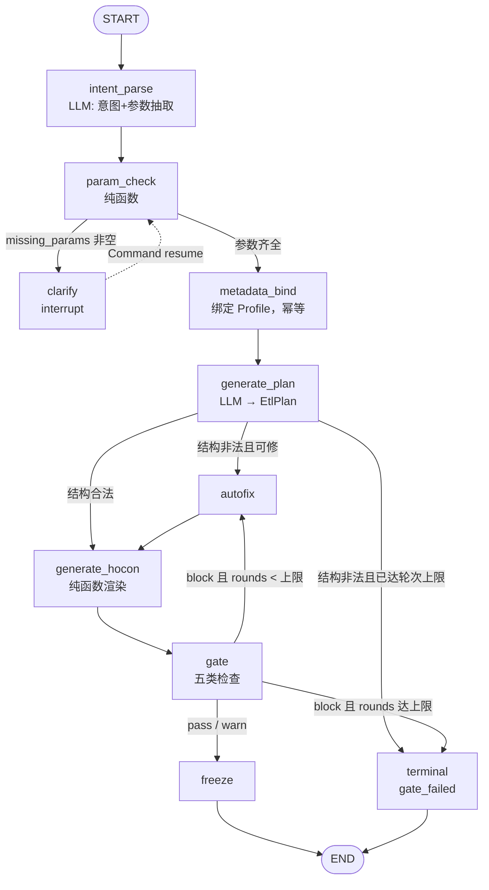

# be-09 LangGraph 工作流与三层状态

> 上游：[概要设计总纲.md](../概要设计总纲.md) §3 三层状态隔离、§4 主流程时序 ｜ [PRD.md](../PRD.md) §6.3.1、§8.1、§12
> 数据：[核心数据字典.md](../核心数据字典.md) §3（`pipeline`、`pipeline_conversation`）、§8（`langgraph_checkpoint*`）
> 代码位置：`backend/workflow/`、`backend/api/pipelines/`、`backend/services/pipeline/` ｜ 里程碑：M2 ｜ 依赖：be-04 be-07 be-08

## 1. 职责与边界

- **做什么**：
  - 定义 LangGraph 状态机（节点、条件边、自动修复回路、终止条件）并驱动一次「自然语言需求 → 候选方案」的完整生成。
  - 维护 **Workflow State**：节点进度、门禁结果、修复轮次；经 `langgraph-checkpoint-postgres` 真落 PostgreSQL，跨请求恢复。
  - 在缺参数时 `interrupt()` 提问，恢复时**跳过已完成的安全探查步骤**（节点幂等）。
  - 用 Redis `KEY_GEN_LOCK`（`gen:lock:{pipeline_id}`）串行化同一 Pipeline 的生成。
  - 落 **Conversation State**（`pipeline_conversation`）并保证对话写入幂等。
  - 守卫 `PipelineStatus` 在本模块职责范围内的合法转移（`draft / generated / gate_failed / version_frozen`）。
- **不做什么**：
  - **不做** EtlPlan / HOCON 的渲染与结构校验（[be-10](be-10-EtlPlan与HOCON生成.md)）。
  - **不做**门禁规则判定与自动修复的控制逻辑（[be-11](be-11-确定性门禁与有限自动修复.md)）；本模块只调用并落状态。
  - **不做**版本冻结与指纹计算（[be-12](be-12-版本冻结与制品指纹.md)）；`freeze` 节点只做「调用 service 并回写 state」。
  - **不做**风险评级（[be-07](be-07-PDP风险策略引擎.md)），**不直接调用** LLM（只经 [be-08](be-08-LLM-Provider抽象层.md) 的 `get_provider()`）。
  - **不写** `execution_run` / `execution_metric` / `quality_report`：Execution State 归 be-14/be-16/be-17。
- **所在分层**：`workflow/`（编排）+ `api/pipelines/`（路由）+ `services/pipeline/`（编排服务）。
  依赖方向：`api/pipelines` → `services/pipeline` → `workflow/` → `engines/` `clients/` `harness/` `models/`。
  `workflow/nodes/*` 允许依赖 `engines/` `clients/llm` `harness/ledger` 与 `services/pipeline/repository.py`（**纯数据访问，不含编排**），**禁止**依赖 `api/` 与 `services/pipeline/orchestrator.py`（避免循环）。

## 2. 模块结构

```
backend/workflow/
├── __init__.py            # 导出 build_graph / EtlWorkflowState
├── graph.py               # build_graph()：节点与条件边装配（待建）
├── state.py               # EtlWorkflowState TypedDict + 归约函数（待建）
├── checkpointer.py        # AsyncPostgresSaver 生命周期与 DSN 归一（待建）
├── interrupts.py          # 中断载荷构造与恢复输入解析（待建）
├── transitions.py         # PipelineStatus 合法转移表（纯函数，单测不需 PG）（待建）
└── nodes/
    ├── __init__.py
    ├── intent_parse.py        # 意图解析：NL → 结构化意图（LLM，task=generate）（待建）
    ├── param_check.py         # 参数完备性检查（纯函数）→ missing_params（待建）
    ├── clarify.py             # 缺参数时 interrupt() 提问（待建）
    ├── metadata_bind.py       # 绑定 MetadataProfile（幂等；resume 时跳过）（待建）
    ├── generate_plan.py       # 调 be-10 生成 EtlPlan（LLM）（待建）
    ├── generate_hocon.py      # 调 be-10 渲染 HOCON（纯函数）（待建）
    ├── gate.py                # 调 be-11 门禁（纯函数 + 证据）（待建）
    ├── autofix.py             # 调 be-11 的修复回路（LLM 回调）（待建）
    └── freeze.py              # 调 be-12 freeze()（待建）

backend/api/pipelines/
├── __init__.py            # 聚合 router（待建）
├── conversation.py        # 创建/查询 Pipeline、对话与恢复（待建）
└── state.py               # Workflow State 只读快照（待建）

backend/services/pipeline/
├── __init__.py
├── orchestrator.py        # run_turn()/resume_turn()：加锁 → ainvoke → 装配响应（待建）
├── conversation.py        # 对话落库与 Idempotency-Key 处理（待建）
└── repository.py          # Pipeline/Profile 的数据访问（禁止调用 workflow/）（待建）
```

## 3. 对外接口

### 3.1 HTTP

| 方法 | 路径 | 权限 | 幂等 | 请求要点 | 响应要点 |
|---|---|---|---|---|---|
| POST | `/api/v1/pipelines` | `maker` | 是（`Idempotency-Key` 必填） | `{name, source_data_source_id, target_data_source_id, description?}` | `{pipeline_id, status:"draft"}` |
| GET | `/api/v1/pipelines` | 项目成员 | — | 分页；按 `tenant_id/project_id` 过滤 | `Page[PipelineBrief]` |
| GET | `/api/v1/pipelines/{pipeline_id}` | 项目成员 | — | — | `PipelineDetail`（含 `status`、`current_version_id`） |
| POST | `/api/v1/pipelines/{pipeline_id}/messages` | `maker` | 是（`Idempotency-Key` 必填） | `{content, params?, message_kind?}` | `PipelineTurnResponse`（见下） |
| GET | `/api/v1/pipelines/{pipeline_id}/messages` | 项目成员 | — | 分页，按 `id` 升序 | `Page[ConversationTurn]`（Conversation State） |
| GET | `/api/v1/pipelines/{pipeline_id}/state` | 项目成员 | — | — | `WorkflowStateSnapshot`（Workflow State **只读**投影） |

`PipelineTurnResponse`：

```json
{
  "pipeline_id": 12,
  "status": "draft|generated|gate_failed|version_frozen",
  "interrupt": {"reason": "missing_params", "questions": [{"param": "primary_key", "prompt": "请指定去重主键"}]},
  "missing_params": ["primary_key", "incremental_column"],
  "assistant_message": {"role": "assistant", "content": "...", "message_kind": "chat"},
  "gate_summary": {"verdict": "pass|warn|block", "blocking": 0, "warnings": 1},
  "terminal_error": null,
  "version": {"version_no": 3, "sha256": "..."}
}
```

`interrupt` 与 `version` 互斥非空；`gate_summary` 仅在门禁已跑过时出现。**门禁阻断不是 HTTP 错误**——它以 `status="gate_failed"` + `gate_summary.verdict="block"` 正常返回 200；只有在**阻断态下强行请求冻结**时才抛 `GATE_BLOCKED`。

### 3.2 Python

```python
# workflow/graph.py
def build_graph(checkpointer: BaseCheckpointSaver) -> CompiledGraph: ...

# services/pipeline/orchestrator.py
async def run_turn(
    session: AsyncSession,
    *,
    ctx: RequestContext,            # tenant_id / project_id / subject_id / request_id
    pipeline_id: int,
    content: str,
    params: dict[str, Any] | None = None,
) -> PipelineTurnResult: ...

# workflow/transitions.py —— 纯函数，无 IO
def can_transition(current: PipelineStatus, event: str) -> PipelineStatus | None: ...
def assert_transition(current: PipelineStatus, event: str) -> PipelineStatus: ...
#   合法 → 返回新状态；非法 → raise ConflictError(code=ErrorCode.CONFLICT)

# workflow/nodes/param_check.py —— 纯函数，无 IO、无 LLM
def find_missing_params(intent: EtlIntent, collected: dict[str, Any]) -> list[MissingParam]: ...
```

**异常契约**：节点内抛出的 `AppError` 一律向上冒泡到 `orchestrator`，由它决定「转为 `gate_failed` 状态」还是「原样上抛给 API 层」：生成类失败（`PLAN_INVALID` / `HOCON_SYNTAX_ERROR` / `AUTOFIX_EXHAUSTED`）落 `terminal_error` 并**正常返回 200**；协议与权限类失败（`TENANT_MISMATCH` / `FORBIDDEN` / `CONFLICT`）直接上抛。

## 4. 数据模型

| 表 | 本模块读/写 | 关键列与约束 |
|---|---|---|
| `pipeline` | 读/写 | 读 `status`、`source_data_source_id`、`target_data_source_id`、`current_version_id`；写 `status`。约束 `uq_pipeline_project_id_name`；查询强制带 `tenant_id`+`project_id` |
| `pipeline_conversation` | 写/读 | Conversation State：`pipeline_id`、`role`、`content`、`message_kind`、`meta`（含 `request_id` 用于去重）、`created_by` |
| `langgraph_checkpoint*` | 读写（经官方库） | `thread_id = str(pipeline_id)`；**由 `langgraph-checkpoint-postgres` 自建，禁止自行实现** |
| `metadata_profile` | 读 | `status`（须为 `ready`）、`sha256`、`expires_at`、`schema_snapshot`、`masked_samples` |
| `idempotency_key` | 读写 | `scope="pipeline.message"`，`key` = 请求头，`request_fingerprint` = sha256(`pipeline_id|content|message_kind`) |
| `etl_plan` / `hocon_artifact` | **不写** | 见 §5.4：草稿只存在 Workflow State，冻结时由 be-12 落库 |
| `evidence_event` | 写（经 `harness/ledger`） | 生成成功写 `PIPELINE_GENERATED` |

## 5. 核心流程

### 5.1 图结构



节点与归约：

| 节点 | 输入 state 字段 | 输出 state 字段 | 是否调 LLM |
|---|---|---|---|
| `intent_parse` | `messages` | `collected_params`、`missing_params`（候选） | 是（`chat`） |
| `param_check` | `collected_params`、`intent` | `missing_params` | 否（纯函数） |
| `clarify` | `missing_params` | `interrupt` 载荷（不写 state） | 否 |
| `metadata_bind` | `source/target_data_source_id` | `profile_ids`、`profile_sha256` | 否 |
| `generate_plan` | `profile_sha256`、`collected_params` | `draft_plan`、`plan_errors` | 是（`chat`） |
| `generate_hocon` | `draft_plan` | `draft_hocon`、`hocon_errors` | 否（纯函数） |
| `gate` | `draft_plan`、`draft_hocon`、`profile_*` | `gate_result` | 否（纯函数） |
| `autofix` | `gate_result`、`draft_plan`、`autofix_rounds` | `draft_plan`、`autofix_rounds`、`autofix_history` | 是（`chat`，经 be-11 注入的回调） |
| `freeze` | `draft_plan`、`draft_hocon`、`gate_result` | `frozen_version_id`、`status` | 否 |

### 5.2 `EtlWorkflowState` 全字段

```python
class EtlWorkflowState(TypedDict, total=False):
    # --- 标识（进入图前固定，节点不得修改）---
    pipeline_id: int
    tenant_id: int
    project_id: int
    subject_id: int
    request_id: str
    # --- 对话（归约：追加）---
    messages: Annotated[list[ChatMessage], _append]
    collected_params: dict[str, Any]       # 已确认的需求参数
    missing_params: list[str]              # 缺哪几项
    env: str                               # Env 的 value
    profile_ids: dict[str, int]            # data_source_id(str) -> metadata_profile.id
    profile_sha256: dict[str, str]
    draft_plan: dict[str, Any] | None      # EtlPlanModel.model_dump()
    plan_errors: list[dict[str, Any]]
    draft_hocon: str | None
    hocon_errors: list[dict[str, Any]]
    gate_result: dict[str, Any] | None     # GateResult.model_dump()
    autofix_rounds: int
    autofix_history: list[dict[str, Any]]  # 每轮：findings 摘要 + patch + diff 摘要
    status: str                            # PipelineStatus 的 value
    terminal_error: str | None             # ErrorCode 的 value
    generation_context: dict[str, Any]     # 交给 be-12 写 pipeline_version
    frozen_version_id: int | None
```

**可被 Checkpoint 序列化的约束**（硬性）：state 内所有值必须能 `json.dumps` —— 只允许 `str / int / float / bool / None / list / dict`（dict 键为字符串）。
**禁止进 state**：ORM 实例、`AsyncSession`、`LLMProvider` / `httpx.Client` / Redis 客户端、`datetime` / `Decimal` / `bytes`、`requests` 风格的可变句柄。时间一律 ISO-8601 字符串，十进制比率一律字符串定标（如 `"0.0500"`），Pydantic 模型一律 `model_dump(mode="json")` 后再入 state。违反此约束时 LangGraph 序列化会失败或产出不可恢复的检查点，属实现期返工项。

### 5.3 中断与恢复

- 触发条件（PRD §6.3.1）：`find_missing_params` 返回非空——缺**主键**、**增量字段**、**去重规则**、**目标表**、**质量阈值**任一即中断。
- `clarify` 节点调用 `langgraph.types.interrupt(payload)`；`payload = {"reason": "missing_params", "questions": [...]}`。中断点之后的节点不会执行，检查点已落 PG。
- `thread_id = str(pipeline_id)`；每次调用传 `config={"configurable": {"thread_id": thread_id}}`。
- 恢复：`graph.ainvoke(Command(resume=user_input), config)`；`user_input = {"content": ..., "params": {...}}`。
- **跳过已完成步骤的机制 = 节点幂等**：每个节点进入时先检查「目标产物是否已在 state 中且输入指纹未变」，是则直接返回（no-op）。`metadata_bind` 因此在 resume 后不会重新探查；`generate_plan` 在已有合法 `draft_plan` 时不会重复调用 LLM。这同时满足「不重复执行已完成的安全探查步骤」（PRD §6.3.1）与生成成本控制。
- **禁止**用进程内字典 / `MemorySaver` 假装持久化（CLAUDE.md §9）。容器重启后 resume 必须仍能继续。

### 5.4 草稿与冻结的界线

候选 EtlPlan / HOCON 在冻结前**只存在于 Workflow State**，不写 `etl_plan` / `hocon_artifact`。理由：这两张表是 `__immutable__` 制品，把每次自动修复的中间产物都插进去会产生大量永不使用的不可变行，且让「制品 = 已批准的事实」这一语义被稀释。冻结时由 [be-12](be-12-版本冻结与制品指纹.md) 一次性落库 5 张制品表 + 1 行 `pipeline_version`。前端中部面板的草稿数据由 `GET /api/v1/pipelines/{id}/state` 提供。

### 5.5 状态机（本模块负责的部分）

| 状态 → 事件 → 新状态 | 事件来源 |
|---|---|
| `draft` → 图产出候选且门禁 `pass/warn` → `generated` | `gate` 节点 |
| `draft` → 门禁 `block` → `gate_failed` | `gate` 节点 |
| `gate_failed` → 修复后门禁 `pass/warn` → `generated` | `autofix`+`gate` 节点 |
| `generated` → 门禁重跑 `block` → `gate_failed` | 手动重跑门禁 |
| `generated` → 冻结成功 → `version_frozen` | `freeze` 节点 |

后续转移（`version_frozen → preparing → pending_approval → approved → committable → queued → running → succeeded/failed/interrupted → rolling_back → rolled_back`，以及 `pending_approval → rejected`）由 [be-13](be-13-准备单与四眼审批.md) / [be-14](be-14-执行编排与Outbox.md) / [be-16](be-16-运行监督与硬中断.md) / [be-18](be-18-原子发布与受管回滚.md) 驱动，本模块只提供 `transitions.py` 的公共转移表。

**非法转移处理**：`assert_transition()` 抛 `ConflictError`（`ErrorCode.CONFLICT`，HTTP 409），**不改动 `pipeline.status`**，并记一条 `structlog` warning（含 `pipeline_id / current / event / request_id`）。典型非法转移：`gate_failed` 下请求冻结、`draft` 下请求 Prepare、`version_frozen` 下再次触发生成。

### 5.6 并发、串行化与幂等

1. `run_turn` 进入时先取 Redis 锁：`SET gen:lock:{pipeline_id} <token> NX EX 600`。
   - 取不到 → 立刻抛 `ConflictError`（`CONFLICT` 409，"该 Pipeline 正在生成中"），**不等待、不排队**。
   - 释放用 Lua 比较并删除（`GET` 比对 token 相等才 `DEL`），避免误删他人锁；节点异常时在 `finally` 释放。
   - 锁 TTL 兜底容器崩溃场景；TTL 常量见 §10。
2. **对话幂等**：`Idempotency-Key` 落 `idempotency_key`（`scope="pipeline.message"`）。同 key 同 `request_fingerprint` → 直接返回 `response_snapshot`；同 key 不同 fingerprint → `IDEMPOTENCY_CONFLICT`（409，`ErrorCode.IDEMPOTENCY_CONFLICT`）。
3. **重复 resume**：无 `Idempotency-Key` 的重复请求由两道防线拦住——(a) Redis 锁保证同一时刻只有一次在图里跑；(b) `pipeline_conversation.meta.request_id` 去重，已存在则视为已处理并返回当前 state 投影，不再 `ainvoke`。
4. `pipeline_conversation` 写入与状态更新在同一事务提交；图执行（含 LLM 调用）在事务之外，避免长事务持锁。

## 6. 关键算法与规则

### 6.1 三层状态隔离

| 层 | 载体 | 生命周期 | 权限边界 | 隔离手段 |
|---|---|---|---|---|
| Conversation State | `pipeline_conversation` | 随 Pipeline 长期存在 | Maker 读写自己项目的会话，项目成员只读 | 只存「说了什么」，**不含**任何进度/制品字段；写入走 `services/pipeline/conversation.py` |
| Workflow State | `langgraph_checkpoint*`（PG） | 跨请求恢复，图跑完归档 | 仅服务端读写；前端只见 `WorkflowStateSnapshot` 投影 | state 里**没有任何** `execution_*` 字段；`GET /state` 做字段白名单裁剪 |
| Execution State | `execution_run` / `execution_metric` / `quality_report` | 一次执行一个实例，不可变 | 操作员触发动作，审计员只读 | 本模块对这三张表**只读**，无写路径 |

**执行状态不得被对话状态覆盖的强制手段**（PRD §8.1）：
1. `WorkflowStateSnapshot` 与 `PipelineTurnResponse` 都**不包含** run 字段；前端要显示运行数据只能查 `/api/v1/runs`。
2. `EtlWorkflowState` 的 schema 白名单由 `state.py` 固定，节点返回未声明键时 `build_graph` 直接报错（LangGraph 对未知键的宽容是隐患，用显式 schema 收敛）。
3. `pipeline.status` 的 `running/succeeded/...` 状态只允许 be-14 及之后的模块写入；本模块的 `assert_transition` 对这批状态没有出边，天然拒绝。

### 6.2 参数完备性（`param_check`，纯函数）

```python
RequiredParam = Literal["primary_key", "incremental_column", "dedup_rule", "target_table", "quality_threshold"]

def find_missing_params(intent: EtlIntent, collected: dict[str, Any]) -> list[MissingParam]: ...
```

判定规则：对每个必需项，先看 `collected`，再回落到 `intent` 的抽取结果；仍为空则进 `missing_params`。`target_table` 有明确例外——若目标 `data_source` 的 `MetadataProfile` 中该表已存在且用户未指定新表，取该表名；否则必需。返回顺序固定为 `RequiredParam` 的声明顺序，保证提问文案稳定（同输入必得同输出）。

### 6.3 门禁结论到状态的映射（纯函数）

```python
def status_after_gate(verdict: Literal["pass", "warn", "block"]) -> PipelineStatus: ...
#   pass / warn -> PipelineStatus.GENERATED ；block -> PipelineStatus.GATE_FAILED
```

### 6.4 自动修复回路（本模块只负责「调」）

控制流在 [be-11](be-11-确定性门禁与有限自动修复.md) 的 `engines/autofix/loop.py`（纯函数，LLM 以回调注入）。本模块的 `autofix` 节点负责：
1. 从 `gate_result.findings` 取出**非策略类** finding（策略类 P0/P1 直接终止，不进入修复）；
2. 调 `run_autofix(..., max_rounds=settings.LLM_AUTOFIX_MAX_ROUNDS, repair=<LLM 回调>)`；
3. 把 `rounds_used`、每轮 `patch` 与 `diff` 摘要追加进 `autofix_history`（这是「保留前后 Diff」的 Workflow State 留痕）；
4. 轮次耗尽 → `terminal_error = ErrorCode.AUTOFIX_EXHAUSTED.value`，`status = gate_failed`。

### 6.5 Checkpointer DSN

`checkpointer.py` 负责把 `Settings` 的连接信息转成 `langgraph-checkpoint-postgres` 所需的 psycopg 连接串，并在应用启动时调用一次 `.setup()`（幂等，内部 `CREATE TABLE IF NOT EXISTS`）。**不使用** SQLAlchemy DSN 形态（`postgresql+asyncpg://` / `postgresql+psycopg://` 不是 psycopg 的合法 DSN），详见 §10。

## 7. 错误码与拒绝语义

| 触发条件 | 错误码 | HTTP | 写证据账本 |
|---|---|---|---|
| 非本项目 / 跨租户访问 Pipeline | `TENANT_MISMATCH` | 403 | 否 |
| 非 `maker` 调用对话接口 | `ROLE_REQUIRED` | 403 | 否 |
| 生成锁已被占用 | `CONFLICT` | 409 | 否 |
| 非法状态转移（如 `gate_failed` 下冻结） | `CONFLICT` | 409 | 否 |
| 同 `Idempotency-Key` 不同请求体 | `IDEMPOTENCY_CONFLICT` | 409 | 否 |
| 绑定的 Profile 已过期（`expires_at < now` 或 `status=expired`） | `METADATA_PROFILE_EXPIRED` | 409 | 否（提示重新探查） |
| LLM 重试耗尽 | `LLM_UNAVAILABLE` | 503 | 否 |
| 生成结果结构非法且修复耗尽 | `AUTOFIX_EXHAUSTED` | 200（`terminal_error` 字段） | 否 |
| 请求体字段缺失/类型错 | `VALIDATION_ERROR` | 422 | 否 |
| 生成成功 | — | 200 | **是**：`PIPELINE_GENERATED`（payload：`{model, model_version, prompt_versions, autofix_rounds, profile_ids}`） |

约定：`PIPELINE_GENERATED` 只记**引用与元数据**，不记需求原文与样本（账本 payload 必须脱敏，见总纲 §4.6）。

## 8. 安全与合规约束

- **租户过滤**：`repository.py` 的每个查询强制带 `tenant_id` + `project_id`；`get_pipeline()` 返回 `None` 而非跨租户数据。
- **权限**：写路径（创建、对话、恢复）要求 `role_assignment` 中存在 `maker`（本项目、`valid_from/valid_to` 覆盖当下）；角色判定查 `role_assignment`，**不用** JWT 内的角色声明（总纲 §4.5）。
- **模型上下文**：state 里的 `draft_plan` / `profile_*` 是拼 prompt 的原料；实际投喂前的脱敏与禁投喂断言由 [be-08](be-08-LLM-Provider抽象层.md) §6.6 强制执行，本模块不得绕过 `get_provider()` 直接调用厂商。
- **Secret**：state 与 `pipeline_conversation` 中**不得出现**任何 Secret 值；HOCON 里的秘密只以 `${...}` 占位符形式存在（be-10 保证）。
- **日志**：`structlog` 绑定 `request_id / tenant_id / project_id / subject_id / pipeline_id`；**不记** `messages.content` 原文与 prompt 正文，只记长度与 `message_kind`。
- **审计**：生成、门禁、冻结三个动作分别产出 `PIPELINE_GENERATED` / `PIPELINE_GATE_EVALUATED` / `PIPELINE_VERSION_FROZEN`，全部经 `harness.EvidenceLedger.append()`。
- **幂等**：见 §5.6。

## 9. 测试要点

**单元测试（纯函数，内存 SQLite，无 PG）**
- `transitions.py`：五条合法转移全部通过；`gate_failed → version_frozen`、`draft → preparing`、`version_frozen → generated` 全部被拒并抛 `CONFLICT`；转移表与 `PipelineStatus` 枚举成员一一对应（防止枚举加值后转移表漏项）。
- `find_missing_params`：五项逐缺失；`target_table` 可从 Profile 回落的两种分支；返回顺序稳定。
- `status_after_gate`：三种 verdict 的映射；state 可序列化——对一棵填满的 `EtlWorkflowState` 断言 `json.dumps` 成功，塞入 `datetime` / ORM 实例时断言失败（**反例**，防止实现期偷懒）。

**集成测试（ECS 上真 PG + Redis）**
- 中断：缺 `primary_key` → 响应含 `interrupt`，`langgraph_checkpoint*` 有该 `thread_id` 的行；补参数 resume → 复用同一 thread，`metadata_bind` 未再次探查（以 `metadata.probe` 工具调用次数为 0 断言）。
- **容器重启恢复**：跑出中断后重启 api 进程，resume 仍成功（证明检查点真落 PG，而非进程内字典）。
- 并发：两个请求同时打同一 `pipeline_id` → 一个 200、一个 409，且 PG 中只产生一条生成记录。
- 幂等：同 `Idempotency-Key` 重放 → `response_snapshot` 一致；同 key 改 `content` → `IDEMPOTENCY_CONFLICT`。
- 三层隔离：构造一条 `running` 的 `execution_run`，断言 `GET /state` 与对话响应中**不出现** run 字段。

**必须覆盖的反例**
- **越权**：跨租户 `pipeline_id` → 404 而非 403 泄露存在性（或 403，二选一并固定，见 §10）；非 maker 调对话接口 → `ROLE_REQUIRED`。
- **超预算/过期**：`metadata_profile.expires_at` 已过 → `METADATA_PROFILE_EXPIRED`，且未发生 LLM 调用。
- **非法转移**：对 `gate_failed` 的 Pipeline 直接冻结 → `GATE_BLOCKED`/`CONFLICT`，`status` 不变。

## 10. 未决与风险

1. **Checkpointer DSN 形态**：`settings.postgres_dsn_sync` 是 `postgresql+psycopg://`，`langgraph-checkpoint-postgres` 需要 psycopg 原生 DSN。**验证方式**：M2 在 ECS 上用真实 PG 建连接并 `.setup()`，通过后在 `Settings` 增加一个 psycopg 原生 DSN 属性。
2. **生成锁 TTL**：暂定 `600 s` 模块常量。若一次含 3 轮自动修复的生成经常超过 6 分钟，锁会在执行中过期并允许并发进入。**建议**将 `GEN_LOCK_TTL_SEC` 提升为配置项并与 be-08 §10.5 的 LLM 总超时预算对齐。**验证方式**：M2 压测最长生成耗时。
3. **跨租户访问的响应码**：404（不泄露存在性）与 403（语义明确）各有理由。本模块倾向 **404**，但需与 be-02 的统一约定一致后再定；在两处实现不一致前不落代码。
4. **`WorkflowStateSnapshot` 的字段白名单**需与前端 fe-04 对齐（中部面板需要 `draft_plan` / `draft_hocon` / `gate_result`，不需要 `autofix_history` 全量）。**验证方式**：fe-04 联调。
5. **检查点归档与对话去重索引**：图跑完后的检查点是否清理尚未决定（**建议**保留 90 天，与 `RUN_LOG_RETENTION_DAYS` 一致，由 be-22 的清理任务执行）；`pipeline_conversation` 目前无 `UK(request_id)`，靠写入前查询去重，存在极小并发窗口（由 Redis 锁抵消），若要强保证需新增部分唯一索引——两项都涉及表结构变更，需拍板。
6. **`autofix_history` 的体积**：每轮含完整 diff，state 体积随轮次增长；上限 3 轮可接受，若未来放开轮次需改为「只存摘要 + 对象存储引用」。**待观察**。

## 11. 变更记录

| 日期 | 变更 | 原因 |
|---|---|---|
| 2026-10-16 | 首版 | M2 生成链路设计 |
