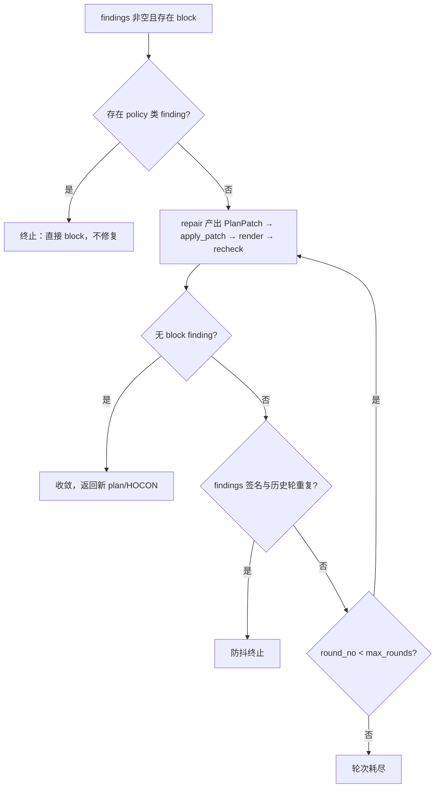

# be-11 确定性门禁与有限自动修复

> 上游：[概要设计总纲.md](../概要设计总纲.md) §4 主流程时序、§5 PDP ｜ [PRD.md](../PRD.md) §6.3.3、§6.3.4、§12
> 数据：[核心数据字典.md](../核心数据字典.md) §3（`etl_plan`、`hocon_artifact`）、§8（`policy_rule`）
> 决策：[需求对齐记录.md](../需求对齐记录.md) §四 风险判定矩阵
> 代码位置：`backend/engines/gate/`、`backend/engines/autofix/`、`backend/services/pipeline/gate.py` ｜ 里程碑：M2 ｜ 依赖：be-07 be-10

## 1. 职责与边界

- **做什么**：
  - 五类**确定性**检查：语法编译、Schema 对齐、字段映射、资源范围、策略——全部纯规则，**无 LLM 参与**（PRD §1.4）。
  - 产出带**可定位信息**的 `Finding` 列表与三值结论 `pass / warn / block`（PRD §6.3.4）。
  - 有限自动修复：≤ `settings.LLM_AUTOFIX_MAX_ROUNDS`（3）轮，逐轮把**结构化 findings** 回灌，保留每轮前后 Diff；轮次耗尽或策略命中 → 停止，转人工。
  - 把结论写入 `pipeline.status`（`generated` / `gate_failed`）与证据事件 `PIPELINE_GATE_EVALUATED`。
- **不做什么**：
  - **不做**风险等级的定义——P0–P3 由 [be-07](be-07-PDP风险策略引擎.md) 的规则表给出，本模块只**消费**结论。
  - **不做** Plan / HOCON 的结构校验（[be-10](be-10-EtlPlan与HOCON生成.md)）；`syntax` 检查包装 `engines/hocon/parser.py`，`schema`/`mapping` 复用 Plan 的字段定义，不重复实现规则。
  - **不调用** LLM 且**不做**冻结/运行期监督：修复所需的模型调用以**回调**形式注入（`RepairFn`），`engines/` 内不出现任何 `clients/llm` 依赖；版本冻结归 [be-12](be-12-版本冻结与制品指纹.md)，运行期预算超限归 [be-16](be-16-运行监督与硬中断.md)——门禁只做**生成期**的静态判定。
- **所在分层**：`engines/gate/`、`engines/autofix/`（纯函数，只依赖 Pydantic + 标准库）+ `services/pipeline/gate.py`（编排、注入 LLM 回调、落状态与证据）。

## 2. 模块结构

```
backend/engines/gate/
├── __init__.py / types.py   # 导出与 DTO：GateResult / Finding / Locator / Severity（待建）
├── gate.py                  # evaluate()：编排五类检查、合成 verdict、短路（待建）
└── checks/                  # syntax（包装 hocon/parser）/ schema（类型矩阵）/ mapping / resource / policy（待建）
backend/engines/autofix/
├── __init__.py              # 导出 run_autofix / apply_patch / diff_plan（待建）
├── loop.py                  # 修复回路控制流（纯函数，LLM 以回调解入）（待建）
├── patch.py                 # PlanPatch 定义与应用（纯函数）（待建）
└── diff.py                  # Plan / HOCON 前后 Diff（纯函数，difflib）（待建）
backend/services/pipeline/gate.py   # 组装输入、注入修复回调、落状态与账本（待建）
```

## 3. 对外接口

### 3.1 HTTP

| 方法 | 路径 | 权限 | 幂等 | 说明 |
|---|---|---|---|---|
| POST | `/api/v1/pipelines/{pipeline_id}/gate/recheck` | `maker` | 是（`Idempotency-Key` 必填） | 对当前草稿重跑五类检查（**不调 LLM、不修复**），响应即 `GateResult`。用于用户在 Studio 手动调整参数后复核 |

门禁的首次执行没有独立路由：它由 `POST /api/v1/pipelines/{id}/messages` 的生成流程内联触发（be-09 §5.1），保证「生成 → 门禁 → 修复」是同一次对话的一体流程。

### 3.2 Python

```python
# engines/gate/types.py
CheckId  = Literal["syntax", "schema", "mapping", "resource", "policy"]
Severity = Literal["info", "warn", "block"]
Verdict  = Literal["pass", "warn", "block"]

class Locator(BaseModel):
    kind: Literal["hocon", "dag", "field"]
    hocon: tuple[int, int, str] | None = None     # kind=hocon：(line 从 1 起, col, hocon_path)
    dag: tuple[str, tuple[str, str]] | None = None # kind=dag：(node_id, edge)
    path: str | None = None                       # kind=field，JSON Pointer 风格

class Finding(BaseModel):
    check_id: CheckId
    code: str                            # 检查子码（见 §6）
    severity: Severity
    locator: Locator | None              # 无法定位时为 None，且此时 message 必须可读
    expected: str | None
    actual: str | None                   # 涉及样本时只填掩码值或类型描述
    message: str                         # 人类可读，**不作为唯一载体**
    rule_ref: str | None                 # 命中 policy_rule.code 时填

class GateResult(BaseModel):
    verdict: Verdict
    findings: list[Finding]
    checks_run: list[CheckId]
    short_circuit: bool                  # 是否因策略命中而短路
    blocking_count: int
    warn_count: int
    evaluated_at: datetime               # 由 service 传入；engines 内不得取当前时间
```

```python
# engines/gate/gate.py —— 纯函数
def evaluate(*, plan: EtlPlanModel, hocon: str,
             source_profile: SchemaSnapshot, target_profile: SchemaSnapshot,
             secret_refs: Mapping[int, frozenset[str]],   # data_source_id -> 已登记键名集合
             policy_ctx: PolicyContext,                   # 由 be-07 定义；含 stage="gate"
             authorized_scope: AuthorizedScope,           # 项目授权范围内的 data_source_id 与库表
             evaluated_at: datetime) -> GateResult: ...

# engines/gate/checks/*.py —— 每个都是纯函数
def check_syntax(hocon: str) -> list[Finding]: ...
def check_schema(plan, source_profile, target_profile) -> list[Finding]: ...
def check_mapping(plan, source_profile, target_profile) -> list[Finding]: ...
def check_resource(plan, authorized_scope) -> list[Finding]: ...
def check_policy(plan, policy_ctx) -> list[Finding]: ...

# engines/autofix/loop.py —— 纯函数；LLM 与渲染/门禁均以回调解入
RepairFn  = Callable[[AutofixRequest], RepairProposal]
RenderFn  = Callable[[EtlPlanModel], str]
RecheckFn = Callable[[EtlPlanModel, str], list[Finding]]

def run_autofix(*, plan: EtlPlanModel, hocon: str, findings: list[Finding], max_rounds: int,
                repair: RepairFn, render: RenderFn, recheck: RecheckFn) -> AutofixOutcome: ...
```

**异常契约**：`engines/` 全部返回数据、不抛领域异常；`apply_patch` 遇非法 JSON Pointer 抛 `PatchError`（本模块内部异常，由 `loop` 捕获并记为「本轮补丁无效」）。service 层把 `GateResult.verdict` 与 `AutofixOutcome.exhausted` 映射为状态与错误码。

## 4. 数据模型

| 表 | 本模块的关系 | 关键列 |
|---|---|---|
| `pipeline` | **写** `status`（`generated` / `gate_failed`） | 转移受 [be-09](be-09-LangGraph工作流与三层状态.md) §5.5 约束 |
| `policy_rule` | **间接读**（经 be-07） | `code`、`level`、`condition`、`enabled`、`version`——门禁不直接查表，由 be-07 传入规则集 |
| `evidence_event` | **写**（经 `harness.EvidenceLedger.append`） | `PIPELINE_GATE_EVALUATED`，payload 见 §5.4 |
| `pipeline_conversation` | **写** | 修复留痕：`role="system"`、`message_kind="autofix"`、`meta` 含 `round_no / patch / diff 摘要（截断）` |
| `etl_plan` / `hocon_artifact` | **不写** | 草稿不落库（be-09 §5.4），门禁只读内存中的草稿 |
| `idempotency_key` | 读写 | `scope="pipeline.gate_recheck"` |

**修复前后 Diff 存哪、怎么存**：不新增表。两层留痕——(a) Workflow State 的 `autofix_history`（随检查点恢复，支持 resume 后继续）；(b) `pipeline_conversation` 一条 `message_kind="autofix"` 的系统消息，`meta` 内放 `round_no`、`PlanPatch`、HOCON 的 unified diff 片段（**截断至 50 行**）与 findings 的 `(check_id, code, locator)` 三元组列表。理由：Conversation State 天然承载「过程」，前端可在对话流中就地展开，且不污染不可变制品表。

## 5. 核心流程

### 5.1 门禁执行顺序与短路

```
evaluate()
 ├─ 1. check_policy    ← 最便宜；命中 P0/P1 → verdict=block, short_circuit=True, 立即返回（不跑后续、不进修复）
 ├─ 2. check_syntax    ← 后续检查需要可解析的 HOCON
 ├─ 3. check_schema    ← 源/目标 Profile 字段与类型对齐
 ├─ 4. check_mapping   ← 映射完整性、主键/去重、转换可行性
 └─ 5. check_resource  ← 资源范围是否在项目授权内 → 合成 verdict（§6.5）
```

### 5.2 自动修复回路



### 5.3 门禁结论到状态

| `verdict` | `pipeline.status` | 后续 |
|---|---|---|
| `pass` / `warn` | `generated` | 允许冻结；`warn` 的警告随版本留痕，前端与 Prepare 页展示 |
| `block` | `gate_failed` | 禁止冻结；若能修复则先走修复回路 |

转移经 be-09 的 `assert_transition`，非法（例如对 `version_frozen` 的 Pipeline 重跑门禁）抛 `CONFLICT`，状态不变。本模块不定义新状态。

### 5.4 证据事件 `PIPELINE_GATE_EVALUATED`

```json
{"verdict": "block", "checks_run": ["policy", "syntax", "schema"], "short_circuit": false,
 "blocking_count": 2, "warn_count": 1, "autofix_rounds": 2,
 "codes": ["hocon/missing_key", "mapping/missing_primary_key"],
 "policy_rule_refs": ["R-P1-CROSSDB"]}
```

payload **不含** HOCON 原文、Plan 全文与任何样本值（账本 payload 强制脱敏，总纲 §4.6）。

## 6. 关键算法与规则

### 6.1 `check_syntax`

包装 `engines/hocon/parser.py`（be-10 §6.4）。`code` 取 parser 的 issue code（`syntax` / `missing_block` / `missing_key` / `unknown_plugin` / `bad_placeholder` / `bad_value`），`severity` 一律 `block`；`locator` 为 `{"kind":"hocon", line, col, hocon_path}`。

### 6.2 `check_schema`

只判断**存在性与类型兼容性**，不改写 Plan。

| code | 判定 | severity |
|---|---|---|
| `source_field_absent` | `FieldMapping.source_field` 在源 Profile 中不存在 | `block` |
| `target_field_absent` | `target_field` 在目标 Profile 中不存在（且目标表已存在、`write_mode != "overwrite"`） | `block` |
| `type_incompatible` | `(source_type, target_type)` 不在兼容矩阵内 | `block` |
| `type_needs_cast` | 在矩阵内但需显式转换，而 `transform_ids` 未含 `cast` | `warn` |
| `nullability_violation` | 源可空 → 目标非空，且无 `not_null` 质量规则 | `warn` |
| `length_truncation_risk` | 源字符串长度上限 > 目标上限 | `warn` |

类型兼容矩阵（行 = 源归一化类型，列 = 目标类型；`✓` 直接兼容，`C` 需显式 cast（`type_needs_cast`），`×` 不兼容 → `type_incompatible`）：

| 源 \ 目标 | int | bigint | decimal | float | varchar | text | date | timestamp | bool | json |
|---|---|---|---|---|---|---|---|---|---|---|
| int / bigint | ✓ | ✓ | ✓ | ✓ | C | C | × | × | C | × |
| decimal | C | C | ✓ | ✓ | C | C | × | × | × | × |
| float / double | C | C | C | ✓ | C | C | × | × | × | × |
| varchar / text | C | C | C | C | ✓ | ✓ | C | C | C | C |
| date | × | × | × | × | C | C | ✓ | ✓ | × | × |
| timestamp | × | × | × | × | C | C | C | ✓ | × | × |
| bool | C | C | × | × | C | C | × | × | ✓ | × |
| json | × | × | × | × | C | ✓ | × | × | × | ✓ |

矩阵是**规则常量**，位于 `engines/gate/checks/schema.py`；扩展类型需同步更新矩阵与单测。归一化类型名由 [be-04](be-04-元数据探查与脱敏.md) 在 Profile 生成时统一（避免 MySQL `int(11)` 与 Doris `INT` 各自为政）。

### 6.3 `check_mapping`

| code | 判定 | severity |
|---|---|---|
| `missing_primary_key` | `write_mode="upsert"` 且 `primary_keys` 为空 | `block` |
| `pk_not_mapped` | `primary_keys` 中的字段未出现在 `field_mappings.target_field` | `block` |
| `dedup_rule_absent` | `write_mode="upsert"` 且无任何 `not_null` 质量规则覆盖主键 | `warn` |
| `duplicate_target_field` | 两个 `FieldMapping` 写同一 `target_field`（且无 transform 合并） | `block` |
| `transform_missing_input` | `TransformSpec.inputs` 指向不存在或未映射的字段 | `block` |
| `transform_kind_mismatch` | `cast` 的 `params.to_type` 与目标列类型不一致 | `warn` |
| `mask_missing_for_sensitive` | 命中的敏感字段没有 `mask` / `hash` 类 transform | `block` |

最后一条是敏感数据红线的静态落点：判定「敏感字段是否以明文出域」。

### 6.4 `check_resource` 与 `check_policy`

| code（resource） | 判定 | severity |
|---|---|---|
| `scope_unauthorized` | 任一 `PlanInput/PlanOutput.data_source_id` 不在项目授权范围内 | `block` |
| `cross_database` / `cross_schema` | 同一 Plan 内的输入/输出跨越多个 `database` 或 `schema_name` | `block` |
| `unknown_table` | 目标表不在目标 Profile 中且 `write_mode="overwrite"` | `warn` |
| `unregistered_secret` | HOCON 占位符对应的 `secret_reference` 未登记（不在 `secret_refs`） | `block` |

`check_policy` **直接消费 [be-07](be-07-PDP风险策略引擎.md) 的判定**，不做二次解释：P0/P1 → `severity="block"` 且 `rule_ref=policy_rule.code`；P2/P3 → 不产出 finding。

**P0/P1 强制 block 的语义切分**：门禁阶段使用的规则集**只包含「制品内可判定」的规则**（`policy_ctx.stage="gate"`）——例如「敏感字段明文出域」「跨租户资源」「跨库/跨 schema」「预算超默认阈值 3 倍」「引用未登记 Secret」「无回滚方案」。需要结合**执行意图与环境**才能判定的规则（如「目标为生产环境且写正式表」「需求意图包含绕过审批」）在门禁阶段**不生效**，由 Prepare 阶段的 PDP 复评（[be-13](be-13-准备单与四眼审批.md)）。这与《需求对齐记录》§四「P1 允许进入审批但强制双审批」并不冲突——两者是同一规则表在**不同阶段、不同输入**上的两次判定。规则表的 stage 作用域由 be-07 定义，见 §10。

### 6.5 严重度与 verdict 的合成

```python
def compose_verdict(findings: list[Finding]) -> Verdict:
    """有 block 则 block；否则有 warn 则 warn；否则 pass。info 只作展示，不参与合成。"""
    return ("block" if any(f.severity == "block" for f in findings)
            else "warn" if any(f.severity == "warn" for f in findings) else "pass")
```

`info` 不参与合成（只作展示）；`blocking_count` / `warn_count` 分别统计对应严重度条数。**短路**：`check_policy` 产出任一 `block` → 立即返回，`checks_run=["policy"]`、`short_circuit=True`。理由：策略命中时语法/Schema 的细节已无关紧要，必须先阻断再讨论。

### 6.6 有限自动修复

```python
class PatchOp(BaseModel):
    op: Literal["set", "add", "remove"]
    path: str                  # JSON Pointer，如 "/inputs/0/columns/2/name"
    value: Any | None = None

class PlanPatch(BaseModel):
    ops: list[PatchOp]

class RepairProposal(BaseModel):
    patch: PlanPatch
    rationale: str             # 模型给出的理由，仅留痕，不作判据

class AutofixRequest(BaseModel):
    round_no: int; plan: EtlPlanModel; hocon: str; findings: list[Finding]

class AutofixRound(BaseModel):
    round_no: int; input_findings: list[Finding]; patch: PlanPatch
    diff: PlanDiff; recheck_findings: list[Finding]

class AutofixOutcome(BaseModel):   # converged / exhausted / stopped_by_debounce 三选一为真
    plan: EtlPlanModel; hocon: str; findings: list[Finding]
    rounds_used: int; converged: bool; exhausted: bool
    stopped_by_debounce: bool; history: list[AutofixRound]
```

控制流约束：

1. 轮次上限 = `settings.LLM_AUTOFIX_MAX_ROUNDS`（默认 3）。`rounds_used` 达到上限仍未收敛 → `exhausted=True` → service 记 `AUTOFIX_EXHAUSTED` 并转人工。
2. **策略类 finding 禁止自动修复**：`check_id == "policy"` 的 `block` finding 一旦出现，`run_autofix` 立即返回（`rounds_used=0`）。理由：让模型去「修掉」策略阻断等于让它绕过安全判定，等同于把 P0/P1 判定交给 LLM（PRD §1.4 明确禁止）。
3. **补丁是唯一变更形态**：模型只能产出 `PlanPatch`（受限 JSON Pointer 操作），不能自由重写整份 Plan——每轮变更可被精确 Diff，且无法夹带与 finding 无关的改动。`apply_patch` 失败（路径不存在 / 类型不匹配）→ 该轮记为无效，`input_findings` 原样带入下一轮，`rounds_used` 照常 +1。
4. **收敛判据与防抖**：`recheck` 返回的 findings 中不含 `block` 即 `converged=True`，立即返回（`warn` 允许残留）；`findings_signature = frozenset((f.check_id, f.code, locator_key(f.locator)) for f in findings)`，若本轮签名与**任一历史轮**相同 → `stopped_by_debounce=True` 并停止。理由：同一错误反复出现说明模型在原地打转，继续烧 token 无收益，应由人介入。

### 6.7 Diff 计算（`engines/autofix/diff.py`，纯函数）

```python
class FieldDiff(BaseModel):        # kind: added / removed / changed
    locator: Locator; kind: str; before: str | None; after: str | None
class PlanDiff(BaseModel):
    plan_changes: list[FieldDiff]; hocon_hunks: list[str]   # unified diff 片段，截断 50 行
    hocon_added: int; hocon_removed: int
```

Plan 用「定义域遍历 + 值比较」生成 `FieldDiff`（比通用 JSON diff 更可控、可定位）；HOCON 用标准库 `difflib.unified_diff`。**不引入第三方 diff 库**。

## 7. 错误码与拒绝语义

| 触发条件 | 错误码 | HTTP | 本模块的角色 | 写证据账本 |
|---|---|---|---|---|
| 策略检查命中 P0/P1 | `GATE_BLOCKED` | 403 | **响应体**返回 `verdict=block` + policy findings；阻断态下继续请求冻结则由 [be-12](be-12-版本冻结与制品指纹.md) 抛出 | 是（`PIPELINE_GATE_EVALUATED`） |
| 门禁 `block`（非策略类，含 `scope_unauthorized`） | — | 200 | **响应体** `verdict=block` + findings（越权资源同样以 finding 呈现） | 是（同上） |
| 修复轮次耗尽 | `AUTOFIX_EXHAUSTED` | 200 | **响应体** `terminal_error`（be-09 §3.2 口径） | 是（同一条门禁事件，含 `autofix_rounds`） |
| 修复过程中 LLM 不可用 | `LLM_UNAVAILABLE` | 503 | **抛出**；保留已完成轮次的 Diff 留痕，状态保持 `gate_failed` | 是 |
| 门禁重跑时的非法状态转移 | `CONFLICT` | 409 | **抛出** | 否 |
| 非本项目 / 跨租户 | `TENANT_MISMATCH` | 403 | **抛出** | 否 |

`POLICY_BLOCKED` 保留给 Prepare / Commit 阶段的 PDP 阻断（be-13），本模块不抛出；`SCHEMA_MISMATCH` 由 [be-10](be-10-EtlPlan与HOCON生成.md) §7 抛出，本模块只以 `source_field_absent` / `target_field_absent` / `type_incompatible` 三个 finding 呈现细节。

## 8. 安全与合规约束

- **确定性不可妥协**：`enforce` 路径（policy/syntax/schema/mapping/resource）**没有任何 LLM 调用**；修复路径可以调 LLM，但修复产物必须重新过全部门禁，且策略类 finding 不参与修复。这保证「P0/P1 拦截率 = 100%」不依赖模型行为（PRD §1.4）。
- **定位可核**：每个 `block` finding 必须有 `locator` 或可读 `message`；两者都缺视为实现缺陷，单测直接失败（PRD §6.3.3）。
- **租户隔离**：`authorized_scope`、`source_profile`、`target_profile`、`secret_refs` 全部由 `services/pipeline/gate.py` 在带 `tenant_id + project_id` 过滤后组装；`engines/` 不接触 DB。
- **Secret 与脱敏**：门禁只校验「占位符名字是否对应已登记的 `secret_reference`」，**不读取、不物化**任何值；finding 的 `actual` 涉及样本时只允许填掩码值或类型描述（如 `"varchar(32)"`、`"***1234"`），禁止回填原始样本。
- **审计与不可变**：门禁结论经 `PIPELINE_GATE_EVALUATED` 入账本，payload 只含计数、代码与规则引用（§5.4）、不含制品原文；本模块不写任何不可变制品表。

## 9. 测试要点

**单元测试（纯函数，无 IO、无 PG）**
- `compose_verdict` 边界（只有 `info` → `pass`；`warn`+`info` → `warn`；`block` 压过 `warn`）；类型兼容矩阵逐格断言，`C` 类在有 `cast` transform 时不产出 finding。
- 短路：policy 命中 block 时 `checks_run == ["policy"]`、`short_circuit is True`，且 `check_syntax` 未被调用（**反例**：策略阻断后仍跑完全部检查）。
- `check_resource`：跨库、跨 schema、未授权 `data_source_id`、未登记 Secret 各一条；`mask_missing_for_sensitive` 在缺 mask transform 时必报 `block`（敏感明文红线的静态拦截面）。
- `run_autofix`：0 轮收敛；3 轮耗尽；**防抖命中**（同一签名第二轮复现 → `stopped_by_debounce=True` 且不再调用 `repair`）；**策略类 finding 出现时 `repair` 零调用**（用计数回调断言）。
- `apply_patch` 非法 JSON Pointer / 类型不匹配 → `PatchError`，且原 plan 未被就地修改（`frozen=True` 天然保证）；`diff_plan` 覆盖 `added/removed/changed` 三分支与 `hocon_hunks` 截断上限。
- 纯函数性：`evaluate` 两次调用结果逐字段相同（`evaluated_at` 由入参决定，不取系统时间）。

**集成测试（内存 SQLite + mock provider）**
- `recheck` 路由：`Idempotency-Key` 重放返回同一 `GateResult` 快照，无 key 时 422；状态落库 `block → gate_failed`、`pass/warn → generated`，两者都写 `PIPELINE_GATE_EVALUATED`。
- 修复留痕：3 轮修复后 `pipeline_conversation` 中有 3 条 `message_kind="autofix"` 的系统消息，`meta["round_no"]` 递增。

**必须覆盖的反例**
- **P0/P1 必拦**：构造「敏感字段明文出域」与「跨库」两条用例，断言 `verdict=block` 且**未进入**自动修复（`autofix_rounds == 0`）——这是 Benchmark 里 `p0p1_block_rate` 的单元级证据（[be-20](be-20-Benchmark评测.md)）。
- **越权与防抖**：`data_source_id` 指向他项目 → `scope_unauthorized` + 403；修复产出的 plan 若与上一轮字节相同 → 防抖必须命中，不得继续消耗轮次。

## 10. 未决与风险

1. **`policy_rule` 的 stage 作用域**：本模块假设规则表能按 `stage`（`gate` / `prepare`）区分生效集合，但 [be-07](be-07-PDP风险策略引擎.md) 尚未定义该字段的形态（数据字典 §8 的 `policy_rule` 只有 `code / level / condition / enabled / version / updated_by`）。**这是本模块与 be-07 之间唯一的硬依赖缺口**，需在 be-07 定案后回填 §6.4。**验证方式**：M2 用「跨库」「敏感明文」两条规则在两个 stage 下分别跑，结果应一 block 一放行。
2. **类型兼容矩阵的完备性**：当前覆盖 8 类归一化类型，未含 `array` / `map` / `decimal(p,s)` 精度维度。**验证方式**：M3 用 Doris 的实际列类型跑一遍，缺失格补进矩阵并加单测。
3. **敏感字段的判定来源**：`mask_missing_for_sensitive` 需要「哪些字段是敏感的」这一事实，当前假设来自 `data_source.sensitive_level` 与 Profile 的字段标注。若 Profile 不含字段级标注，该检查退化为按数据源级敏感度粗判。**需与 be-04 对齐**字段级标注是否落 `schema_snapshot`。
4. **修复的 token 成本**：3 轮 × 一次完整 plan 重渲染，单次生成最坏约 4 次 LLM 调用。**待观察**：Benchmark L0 统计平均轮次；若 > 1.5 需优化修复模板（例如只投喂相关片段）。
5. **`message_kind="autofix"` 的语义扩张**：`pipeline_conversation` 本是「人和模型说了什么」，现在承载修复留痕。若后续出现第三种过程留痕（例如门禁历史），该表会变成杂物间。**建议**在出现第三种用途时抽取 `pipeline_generation_trace` 表——需拍板并同步数据字典。
6. **HOCON 层缺陷的可修性**：当 finding 只在 HOCON 层可修（例如连接器键名拼错）而 Plan 层无对应字段时，`PlanPatch` 表达不了。当前策略是「这类问题由 `render.py` 的确定性映射保证不出现」，属**假设**而非保证。**验证方式**：M2 用 50 条 Benchmark L0 用例统计 `code` 分布，确认无孤立 HOCON 层缺陷。

## 11. 变更记录

| 日期 | 变更 | 原因 |
|---|---|---|
| 2026-10-16 | 首版 | M2 生成链路设计 |
