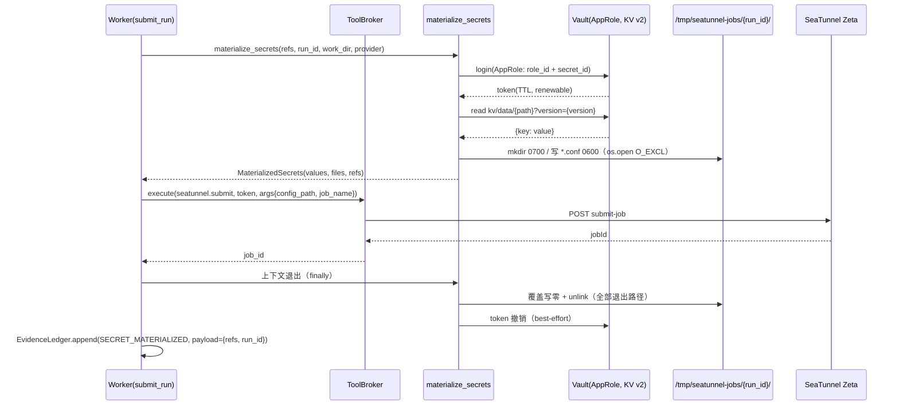

# be-15 SeaTunnel 客户端与 Secret 物化

> 上游：[概要设计总纲.md](../概要设计总纲.md) §2 进程拓扑、§5 Harness 安全执行内核、§6 数据流与安全边界、§8 运行监督 ｜ [PRD.md](../PRD.md) §6.5.1 任务执行、§6.5.2 运行监督
> 数据：[核心数据字典.md](../核心数据字典.md) §2 数据源与元数据（`data_source` / `secret_reference`）、§3 Pipeline 与制品（`hocon_artifact`）
> 代码位置：`backend/clients/seatunnel/`、`backend/clients/secrets/` ｜ 里程碑：M3 ｜ 依赖：be-03 数据源与密钥引用、be-14 执行编排与 Outbox
> 交界（只引用，不定义）：`clients/target/` 的 Swap 属 be-18

## 1. 职责与边界

- **做什么**
  - 封装 SeaTunnel Zeta REST 客户端：提交、停止、查状态、取指标；含超时、重试与防重复提交。
  - 把不可变制品 `hocon_artifact.content` 渲染为**可提交的运行配置**：替换 Secret 占位符、注入 run 级参数（影子表名、错误表名）。
  - 封装 `SecretProvider` 抽象与 Vault（KV v2 + AppRole）实现：登录取 token、按 `version` 读取、续期、失败重试。
  - 把 Secret 物化为临时文件或环境变量，并保证在**所有退出路径**（含异常）销毁。
  - 生成作业名（含 `run_id`）并对账；对提交失败做异常分类。
- **不做什么**
  - **不做授权判定、不验 Capability、不碰 `jti`**——那全是 `harness`（be-05）的职责。本模块的 `submit` / `stop` 只能由 `harness.broker.ToolBroker` 调用。
  - 不写 `execution_run` / `outbox_message`（be-14），不写证据账本的事件哈希（be-06）——只**请求**写事件。
  - 不做原子 Swap 与目标端回滚（be-18），不做质量分流（be-17），不做预算判定（be-16）。
  - 不落任何 Secret 到磁盘持久位置、日志、异常消息、`jsonb` 列。
- **所在分层**：`clients/`（外部系统封装，允许网络与 IO，但**不含业务判定**）。依赖方向：`harness/broker.py` → `clients/seatunnel`；`clients/*` 不 import `services` / `api` / `harness`。

## 2. 模块结构

```
backend/clients/
├── seatunnel/
│   ├── __init__.py        # 对外只导出 SeatunnelClient / JobStatusDTO / JobMetricsDTO（待建）
│   ├── client.py          # （待建）REST 客户端：submit / stop / status / metrics + 重试与防重
│   ├── job.py             # （待建）配置物化：占位符替换、作业命名、run 级参数注入
│   └── models.py          # （待建）DTO：JobStatusDTO / JobMetricsDTO / SubmitResult / JobFailureKind
├── secrets/
│   ├── __init__.py        # 导出 SecretProvider / MaterializedSecrets（待建）
│   ├── vault.py           # （待建）VaultSecretProvider：**包住 be-03 的 clients/vault.VaultClient**，不重复实现 AppRole/KV 逻辑
│   └── materialize.py     # （待建）materialize_secrets 上下文管理器 + 临时文件生命周期
└── target/                # be-18 拥有（base.py / registry.py / Doris|MySQL TargetPublisher）；本模块只引用其接口名
```

**与 be-03 的分工（文件不重名、职责不重叠）**：`clients/vault.py: VaultClient`（be-03）是低层 HTTP 封装（`login_approle` / `read_kv(path, version=...)` / `health` / `build_path`，写入侧与运维脚本也用它）；`clients/secrets/vault.py: VaultSecretProvider`（本模块）是**执行侧**适配器：在 `VaultClient` 之上加 token TTL 续期、`path`+`version` 到 `SecretRefView` 的解析、RetryPolicy 与脱敏包装。两边都不得各自实现一份 AppRole。

## 3. 对外接口

本模块**无 HTTP 路由**（控制面不暴露 SeaTunnel 代理；`/api/v1/runs` 属 be-14）。对外接口全部是 Python 侧，且写操作只允许被 `ToolBroker` 调用。

### 3.1 SeaTunnel 客户端

```python
# clients/seatunnel/client.py
class SeatunnelClient:
    def __init__(self, base_url: str, *, timeout_sec: float = 10.0) -> None: ...

    async def submit(self, config_path: Path, *, job_name: str, job_id: str | None = None) -> SubmitResult:
        """提交作业，返回 SubmitResult{job_id, accepted_at}。
        幂等：先按 job_name 查重（status 为 RUNNING 则直接返回既有 job_id），再 POST。
        异常：SeatunnelUnavailable / SeatunnelRejected / SeatunnelTimeout（见 §7）。"""

    async def stop(self, job_id: str) -> None:
        """停止作业。作业已结束 → 视为成功（幂等），不抛异常。"""

    async def status(self, job_id: str) -> JobStatusDTO:
        """JobStatusDTO{job_id, state, started_at, finished_at, error_summary}。
        state 取值由 seaTunnel 原始字符串映射到内部枚举（映射表见 §6.4）。"""

    async def metrics(self, job_id: str) -> JobMetricsDTO | None:
        """读取作业指标。**不可用时返回 None**（不是抛异常）——be-16 据此走退化路径。"""

    async def find_by_name(self, job_name: str) -> str | None:
        """按作业名反查 job_id，用于重投时的防重复提交与对账。"""
```

### 3.2 配置物化

```python
# clients/seatunnel/job.py
def build_job_name(*, pipeline_id: int, version_no: int, run_id: int) -> str:
    """etl-{pipeline_id}-v{version_no}-run{run_id}；只含数字与连字符，不含任何用户输入。"""

def render_config(
    *,
    hocon_content: str,
    secrets: MaterializedSecrets,
    run_params: Mapping[str, str],
) -> str:
    """替换 ${secret:...} 占位符并注入 run 级参数（shadow_table / error_table / job_name）。
    返回的字符串**只允许写入临时文件**，禁止进日志、禁止进异常、禁止进 Pydantic 响应模型。"""

def injection_report(rendered: str) -> InjectionReport:
    """脱敏的替换记录：{placeholders_total, replaced_keys: [key_name], unresolved: [path#key]}。
    这是唯一允许进日志/账本的形式——只记键名与引用，不记值。"""
```

### 3.3 Secret 物化

```python
# clients/secrets/materialize.py
class SecretProvider(Protocol):
    def resolve(self, *, path: str, version: int) -> dict[str, str]:
        """返回该 Vault 路径下的键值对。只允许在 Worker 内存中存在。"""

@dataclass(slots=True)
class MaterializedSecrets:
    values: dict[str, str]        # 键名 → 值；仅在内存
    files: list[Path]             # 已写入的临时配置路径
    refs: list[str]               # 已物化的引用标识（path#key），用于审计
    def destroy(self) -> None: ...  # 覆盖写 + 删除文件，清空 values

@contextmanager
def materialize_secrets(
    refs: Sequence[SecretRefView],
    *,
    run_id: int,
    work_dir: Path,
    provider: SecretProvider,
    mode: Literal["env", "file"] = "file",
) -> Iterator[MaterializedSecrets]:
    """物化 → yield → **finally 无条件 destroy**（含异常路径）。"""

# clients/secrets/vault.py —— 内部持有 be-03 的 VaultClient，只加执行侧逻辑
class VaultSecretProvider:
    def __init__(self, client: VaultClient, *, timeout_sec: float) -> None:
        """`client` 由 service 依 Settings 构造（`VAULT_ADDR`/`VAULT_KV_MOUNT`/`VAULT_ROLE_ID`/`VAULT_SECRET_ID`）。"""
    def login(self) -> None: ...                  # 委派 VaultClient.login_approle()，记录 lease_duration
    def ensure_token(self) -> None: ...           # TTL 剩余 < 20% 时续期/重登
    def resolve(self, *, path: str, version: int) -> dict[str, str]: ...   # 委派 VaultClient.read_kv(path, version=version)
    def close(self) -> None: ...                  # 撤销 token（best-effort）
```

`SecretRefView`（`schemas/datasource.py`，**be-03 提供**，取值见 [be-03](be-03-数据源与密钥引用.md) §3.2 与 `masked_secret_view()`）是 `secret_reference` 的投影：`{provider, path, version, key_names, masked_values}`，**不含明文**；本模块只用其中的 `path` / `version` / `key_names`。

## 4. 数据模型

本模块**不新增表**，只读以下既有表（全部经 service 传入 DTO，`clients/` 不持有 ORM 会话）：

| 表 | 用途 | 关键列 |
|---|---|---|
| `secret_reference` | 解析 Vault 路径与版本 | `provider`、`path`、`version`、`key_names`、`last_rotated_at` |
| `data_source` | 作业定位（不含凭据） | `endpoint`（host/port/database/table）、`secret_ref_id`、`type`、`sensitive_level` |
| 🔒 `hocon_artifact` | 待渲染的配置模板 | `content`（含占位符）、`sha256`、`parser_version`、`validation_result` |
| `preparation` | 取 `resource_scope`（哪个表、哪个 Secret 引用） | `resource_scope`、`environment` |
| `execution_run` | 作业名与临时目录的 run 标识 | `id`、`seatunnel_job_id`、`shadow_table`、`formal_table`、`error_table` |

约束（既有，本模块只消费）：`uq_secret_reference_provider_path_version`、`uq_pipeline_version_sha256`。**本模块不得写任何 `jsonb` 列**——渲染后的配置永不落库（`hocon_artifact.content` 是不可变模板，替换结果只存在于 Worker 临时文件与进程内存）。

## 5. 核心流程

### 5.1 Secret 物化全链路时序



编号步骤与不可省略的细节：

1. `refs` 来自 `preparation.resource_scope.secrets`（be-13 在 Prepare 时固化）。**不在 `resource_scope` 中登记的引用一律不解析**——HOCON 里出现未登记占位符 → 直接失败（fail-closed），不静默替换为空。
2. AppRole 登录：`role_id` 取自 `Settings.VAULT_ROLE_ID`，`secret_id` 取自 `Settings.VAULT_SECRET_ID`（`SecretStr`）；两者由 ECS 侧 `.env` 提供，**不进仓库**。登录失败重试 2 次（间隔 1 s / 2 s），仍失败 → `SecretUnavailable`。
3. KV v2 读取：`GET {VAULT_ADDR}/v1/{VAULT_KV_MOUNT}/data/{path}?version={version}`，**必须带显式 `version`**（KV v2 默认读 latest，而我们要的是 `secret_reference.version` 那一版，否则轮转后行为不可复现）。响应取 `data.data` 字典。
4. 版本不存在或键缺失 → `SecretUnavailable`（不降级、不回退到 latest、不打印响应体）。
5. 写临时文件：目录 `SEATUNNEL_WORK_DIR`（默认 `/tmp/seatunnel-jobs`）下 `/{run_id}/`，`mkdir(mode=0o700, exist_ok=False)`；文件名由**代码常量**生成（如 `job.conf`），**不含任何用户输入**；用 `os.open(..., O_WRONLY|O_CREAT|O_EXCL, 0o600)` 创建，防符号链接与覆盖。
6. 把 `render_config()` 的结果写入该文件；替换过程的报告只记键名（`injection_report`）。
7. 退出上下文时（`finally`）：先以零字节覆盖再 `unlink()` 每个文件，`shutil.rmtree(dir, ignore_errors=True)`，最后清空 `MaterializedSecrets.values`。**异常路径同样执行**——这是 `@contextmanager` 的唯一理由。
8. 审计事件 `secret.materialized`：payload 只记 `{run_id, refs: ["kv/etl/project-1/ds-12#password"], mode, file_count}`，**绝不记值、绝不记渲染后配置**。
9. Vault token 撤销为 best-effort：撤销失败只记 warning，不影响主流程（token 有 TTL 且 Worker 短生命周期）。

### 5.2 提交作业时序（`tasks.execution.submit_run` 内部）

1. 载入 `run` / `preparation` / `pipeline_version` / `hocon_artifact`（be-14 传入 Pydantic DTO）。
2. `build_job_name(pipeline_id, version_no, run_id)`。
3. `client.find_by_name(job_name)`：已有同名的 RUNNING 作业 → **直接复用其 `job_id`**，不再提交（重投防线第一层）。
4. `materialize_secrets(...)`（be-15）。
5. `render_config(hocon_content, secrets, run_params)`，其中 `run_params = {"shadow_table": ..., "error_table": ..., "job_name": ...}` 指向目标端；**不含凭据**。
6. `ToolBroker.execute(ToolName.SEATUNNEL_SUBMIT, token, args={config_path, job_name}, ctx=ExecutionContext(caller="worker", tenant_id=..., project_id=..., actor_id=None, run_id=run_id), session=session)`：`token` 即 `etl.seatunnel.submit` 载荷里的 `capability`（be-14 §5.1 第 ⑦ 步）；broker 内部完成验签与 `jti` 原子消费，再调用 `client.submit`。
7. 回写 `execution_run.seatunnel_job_id = job_id`、`status = running`、`started_at`（be-14）。
8. 退出物化上下文 → 文件销毁。

**顺序不可颠倒**：Secret 物化排在 `ToolBroker.execute` **之前**。理由：`execute` 会原子消费 `jti`，一旦消费成功而物化失败，Capability 已烧毁，重试必然 `CAPABILITY_REPLAYED`。物化本身对目标系统**无副作用**（对 Vault 是读），因此「先物化、后消费」既安全又让重投可恢复。

### 5.3 停止作业时序（硬中断 / 人工取消）

1. 由 be-14 入队 `etl.run.stop` → `tasks.execution.stop_run(run_id, reason)`。
2. 若 `execution_run.seatunnel_job_id` 为空（作业尚未提交）→ 直接把 run 置目标状态并返回（无需停止）。
3. `ToolBroker.execute(ToolName.SEATUNNEL_STOP, token, args={job_id}, ctx=ExecutionContext(caller=...), session=session)` → `client.stop(job_id)`。
4. 作业已结束（404 / state=FINISHED）→ 视为成功。
5. 停止失败 → 重试 3 次（退避 1/2/4 s）→ 仍失败则记 `failure_snapshot.needs_manual_stop = true` 并告警；run 状态由 be-16 / be-14 决定（`interrupted` 优先，见 be-16 §5.4）。

### 5.4 作业失败分类

| 分类 | 判据 | 处理 |
|---|---|---|
| `CONNECT_FAILED` | 客户端抛出连接类异常；Zeta 状态含 `CONNECT` / `UnknownHost` | 可重试一次；仍失败 → `failed` |
| `CONFIG_REJECTED` | 提交返回 4xx，或状态错误含 `ParseException` / `Config` | **不可重试**（配置是冻结制品，重试无意义） |
| `RESOURCE_INSUFFICIENT` | 状态含 `OutOfMemory` / `NoSpace` / `Container` | 不可自动重试，告警 |
| `KILLED` | `stop` 后作业进入 FINISHED，且停止是被主动发起的 | 由调用方语义决定（中断 / 取消） |
| `UNKNOWN` | 其他 | 记原文摘要（截断 200 字符，过脱敏），转 `failed` |

分类结果写入 `execution_run.error_message`（脱敏摘要）与 `run.failed` 证据事件；**Zeta 原始堆栈不得整段入账本**。

## 6. 关键算法与规则

### 6.1 Secret 占位符语法与替换时机

- 语法：`${secret:<vault_path>#<key_name>}`，例：`${secret:kv/etl/project-1/ds-12#password}`。`<vault_path>` 与 `secret_reference.path` 字面相等（不含 mount 前缀），`<key_name>` 必须在 `secret_reference.key_names` 内。
- 转义：`$${secret:...}` 表示字面量（不替换），供目标端 SQL 中出现同类文本时使用。
- 校验：`render_config` 先用正则 `\$\{secret:([^}#]+)#([^}]+)\}` 抽出全部引用；**任何一个引用的 `(path, key_name)` 不在 `refs` 集合内 → 抛 `SecretUnavailable`**（fail-closed，不做部分替换）。
- 替换时机：仅在 Worker 进程内存与临时文件中；替换后的字符串**永不**进入日志、异常消息、Pydantic 响应模型、证据账本、`execution_run` 任何列。
- 错误信息脱敏：异常消息只含 `path` 与 `key_name`（引用层信息），若底层库（hvac / httpx）的异常文本包含 URL 查询串，包装时**丢弃原始文本**，只保留 `error_type` 与 `path`。

### 6.2 临时文件与路径安全

| 项 | 规则 |
|---|---|
| 根目录 | `Settings.SEATUNNEL_WORK_DIR`（容器内 `/tmp/seatunnel-jobs`），启动时校验存在且属 Worker 用户，否则 fail-fast |
| 子目录 | `{work_dir}/{run_id}`（`run_id` 为 int，天然无路径穿越）；`mkdir(mode=0o700, exist_ok=False)` |
| 文件名 | 代码常量 `job.conf`；**不拼接** 用户可控字符串（表名、作业名一律写在文件**内容**里，不进文件名） |
| 创建方式 | `os.open(path, O_WRONLY|O_CREAT|O_EXCL, 0o600)`——`O_EXCL` 阻断符号链接攻击；不用 `Path.write_text`（其默认权限受 umask 影响） |
| umask | Dockerfile 内 `RUN umask` 不可持久，故在 `clients/secrets/materialize.py` 模块导入时不设全局 umask，而是**显式传 mode**（显式优于依赖进程状态） |
| 运行用户 | 容器内非 root（`USER app`，be-22 落实）；Workdir 属该用户 |
| 清理 | `finally` 覆盖写 + unlink + rmtree；`atexit`/SIGTERM 兜底注册（Worker 被 OOM kill 时无法跑 finally，故 `submit_run` 任务开始时先 `rmtree(work_dir/{run_id}, ignore_errors=True)` 清残留） |

### 6.3 Vault 失败与 fail-closed

| 情形 | 行为 |
|---|---|
| `VAULT_ADDR` 不可达 / 连接超时（`VAULT_TIMEOUT_SEC=10`） | 重试 2 次 → `SecretUnavailable` → 不消费 `jti` → Outbox 退避重投 |
| AppRole 认证失败（401） | 不重试（凭据错了重试无用）→ `SecretUnavailable` + 告警 |
| token 过期（403） | 重新登录一次；再失败 → `SecretUnavailable` |
| 路径/版本不存在（404） | 不重试 → `SecretUnavailable`（引用被误删或版本轮转清理） |
| 有任何一项失败 | **整体失败**，不部分物化、不返回残缺配置 |

token TTL 管理：登录响应中的 `lease_duration` 记入内存；`ensure_token()` 在「剩余 TTL < 20%」时续期；续期失败重登。鉴权方式用 **AppRole**（`VAULT_ROLE_ID` + `VAULT_SECRET_ID`），`VAULT_TOKEN` 仅用于开发/运维脚本，**Worker 不使用静态 token**。

### 6.4 SeaTunnel Zeta 端点与重试

| 操作 | 方法与路径（Zeta local 模式，基址 `settings.seatunnel_api_base`） | 备注 |
|---|---|---|
| 提交 | `POST {base}/hazelcast/rest/maps/submit-job?jobId={job_id}&jobName={job_name}`，body = 配置文件内容 | `jobId` 由**本模块**从 `run_id` 派生（`uuid5(NAMESPACE, f"run:{run_id}")`），使重投拿到同一 id，Zeta 侧重复提交被拒即视为已提交 |
| 停止 | `POST {base}/hazelcast/rest/maps/stop-job`，body = JSON `{"jobId": ...}` | 幂等：作业不存在时按成功处理 |
| 状态 | `GET {base}/hazelcast/rest/maps/job-info/{job_id}` | 映射到内部状态枚举 |
| 指标 | `GET {base}/hazelcast/rest/maps/job-metrics/{job_id}` | **可用性待实机验证**，不可用返回 `None` |
| 枚举 | `GET {base}/hazelcast/rest/maps/running-jobs` | 用于 `find_by_name` 对账 |

重试策略：

| 操作 | 重试 | 理由 |
|---|---|---|
| `submit` | **最多 1 次**，且仅在「连接前失败」（连接超时、DNS 失败）时重试 | 提交是产生作业的副作用；返回 5xx 时结果**不确定**（可能已创建）。此时**先 `find_by_name` 查重**，查到则复用，查不到才重试 |
| `stop` | 最多 3 次，退避 1/2/4 s | 停止失败会留下运行中的作业，代价高 |
| `status` / `metrics` | 最多 2 次；仍失败则返回 `None`（be-16 走退化路径） | 只读，失败不该阻塞监督 |

提交前的三道防重：① `execution_run.status` 非 `queued` 直接返回；② `find_by_name(job_name)` 命中则复用；③ `job_id` 由 `run_id` 派生（`uuid5(NAMESPACE, f"run:{run_id}")`），同一 run 永远得到同一 `jobId`，Zeta 侧同 id 重复提交被拒即视为已提交。

### 6.5 状态映射

| Zeta 原始状态 | 内部 `JobState` | 映射到 `RunStatus`（be-14 消费） |
|---|---|---|
| `RUNNING` / `SCHEDULED` | `RUNNING` | `running` |
| `FINISHED`（且无误） | `FINISHED` | 待质量报告决定（be-17/be-18） |
| `FAILED` / `CANCELED`（非主动停止） | `FAILED` | `failed` |
| `CANCELED`（本模块发起 stop） | `STOPPED` | 由调用方语义决定（`cancelled` / `interrupted`） |
| 查询 404 | `NOT_FOUND` | 由调用方决定（可能是尚未调度） |
| 其他/未知 | `UNKNOWN` | 不自动推进状态，记 warning |

## 7. 错误码与拒绝语义

本模块**不自造错误码**，`clients/` 只抛两类**内部异常**（不属于 `core/errors.ErrorCode` 契约，不出现在 API 响应）并由 `ToolBroker` / `tasks` 映射：

| 内部异常 | 定义位置 | 上游映射 | 写证据账本 |
|---|---|---|---|
| `SecretUnavailable` | `clients/secrets/__init__.py` | `tasks.execution.submit_run` → 记 warning，**不消费 jti**，交给 Outbox 退避；超限后 run → `failed` | 否（无外部副作用）；run 终结时写 `run.failed` |
| `SeatunnelUnavailable` / `SeatunnelRejected` / `SeatunnelTimeout` | `clients/seatunnel/models.py` | `submit_run` → `failed`（`CONFIG_REJECTED` 不重试；连接类可重试一次） | 是（`run.failed`） |

面向 API 的映射（由 be-14 落地）：Secret 物化失败与 SeaTunnel 不可达目前都只能落 `INTERNAL_ERROR`；Capability 相关拒绝（`CAPABILITY_INVALID` / `CAPABILITY_EXPIRED` / `CAPABILITY_REPLAYED` / `UNAUTHORIZED_TOOL`）与 `ROLLBACK_FAILED` / `SWAP_FAILED` 由 harness 侧产生，本模块不参与。细分码缺失见 §10 第 1 条。

## 8. 安全与合规约束

- **无明文 Secret**（本模块的核心红线，落点如下）
  | 位置 | 规则 |
  |---|---|
  | 日志 | 只记 `path#key` 引用与 `injection_report` 的键名；渲染后配置只在 `DEBUG` 下以**长度与哈希**形式记录（`rendered_sha256`, `rendered_len`），从不记内容 |
  | 异常 | 包装底层异常时丢弃原始文本，只留 `error_type` + 引用 |
  | 数据库 | 不写任何 `jsonb` / `text` 列；`execution_run.failure_snapshot` 只允许来自 be-16 的脱敏摘要 |
  | 账本 | `secret.materialized` payload 只含引用与计数 |
  | API | 本模块无路由，不存在响应泄漏面；be-14 的 `RunDetail` 不含任何配置内容 |
  | 磁盘 | 仅临时文件（0600，run 级目录 0700），退出即销毁；容器 `tmpfs` 挂载（be-22，建议） |
- **副作用唯一出口**：`submit` / `stop` 只能经 `ToolBroker.execute()` 调用；`clients/` 内不做 `tool` 白名单判定（那是 broker 的职责），但**不提供**任何绕过 broker 的便捷函数（如 `submit_direct`）。
- **fail-closed**：Vault 不可达、引用未登记、版本不存在、键缺失、渲染失败——一律失败，**没有任何降级为「用空值/默认值继续」的分支**。
- **最小权限**：Vault AppRole 只授予该租户路径（`kv/etl/project-{id}/*`）的 **read** 权限；不授予 `list` / `create` / `update`。Secret 轮转周期 90 天（`secret_reference.last_rotated_at` 追踪）。
- **租户过滤**：本模块不查库；传入的 DTO 由 be-14 的 service 在带 `tenant_id` 的查询中取出，因此 `clients/` 只处理已授权范围内的引用。
- **审计**：`secret.materialized` 由调用方（be-14 的 `submit_run`）在物化成功后写入；本模块只提供 `MaterializedSecrets.refs` 作为 payload 来源。

## 9. 测试要点

**单元测试（本机无 Docker 时全靠 fake provider）**

- `SecretProvider` Protocol 的多实现：
  ```python
  class FakeSecretProvider:      # tests 用：值从字典读，可注入失败（timeout / 404 / 缺键）
      def __init__(self, values: dict[tuple[str, int], dict[str, str]], *, fail_mode=None) -> None: ...
  ```
  同一套 `materialize_secrets` 用例跑在 `FakeSecretProvider` 与（集成环境）`VaultSecretProvider` 上，保证语义一致。
- `materialize_secrets`：正常销毁（文件不存在、`values` 已清空）；**异常路径销毁**（在 yield 后抛异常，断言临时文件已被删除）；`run_id` 目录已存在时不复用（`exist_ok=False` 抛错）。
- `render_config`：占位符全替换；未登记引用 → `SecretUnavailable`；转义 `$${secret:...}` 不替换；`injection_report` 只含键名。
- **敏感值不泄漏断言**：设 `values = {"password": "P@ssw0rd-UNIQUE-CANARY"}`，跑完整物化+渲染，捕获 `caplog` 与所有 `str(exc)`，断言 canary 字符串**不出现在任何输出中**。
- `build_job_name`：含 `run_id`、只含 `[a-z0-9-]`。
- 状态映射表：Zeta 原始字符串 → 内部枚举的全覆盖，未知值落 `UNKNOWN`。

**集成测试（ECS，标 `integration`）**

- Vault **dev 模式容器**（`vault server -dev` + `vault kv put kv/etl/project-1/ds-12@1 ...`）：AppRole 绑定、按 `version` 读取（写 version 2 后读 version 1 必须拿到旧值）、token 续期、权限不足路径（无权限的 path → 403）。
- SeaTunnel 容器：提交一个最小 HOCON（`LocalFile` → `LocalFile`）拿到 `job_id`；`status` 返回 `RUNNING`；`stop` 后 `status` 为已结束；**`metrics` 是否可用**并记录实测结果（决定 be-16 退化路径的默认值）。
- **防重复提交**：对同一 `job_name` 连续 submit 两次，断言 SeaTunnel 侧只有一个作业，第二次返回同一 `job_id`。
- `metrics` 不可用时返回 `None`（用一个指向不存在端点的 base_url 验证客户端不抛异常）。

## 10. 未决与风险

1. **SeaTunnel Zeta REST 端点路径未实机核对**：§6.4 的路径按 Zeta 2.3.x 的 Hazelcast REST 命名写出，但版本差异（如 `job-info` vs `job-metrics` 的实际命名、是否需要用 `jobId` 查询参数）**未验证**。验证方式：M3 起 `seatunnel` 容器后 `curl` 逐个核对；端点集中在 `clients/seatunnel/client.py` 的模块级常量，改常量即可，不改调用点。**若 Zeta 不提供 `job-metrics`，be-16 的退化路径成为默认路径**（见 be-16 §6.3）。
2. **`VAULT_SECRET_ID` 的存放方式未定**：当前设计从 `.env` 读（`SecretStr`）。更严的做法是 secret_id 由 ECS 侧文件挂载或 Vault Agent 注入。验证方式：be-22 定稿时确认 ECS 部署是否引入 Vault Agent；若不引入，则接受 `.env`（该文件权限 0600 且不进仓库）。
3. **`tmpfs` 挂载未定**：建议把 `SEATUNNEL_WORK_DIR` 挂到容器 `tmpfs`，使临时 Secret 文件不进容器可写层（也避免容器被 commit 时泄漏）。验证方式：be-22 在 compose 中确认 `tmpfs` 支持；不支持则退化为「临时文件 + 启动时清扫残留」。
4. **`job_id` 由 `uuid5(run_id)` 派生**是否会导致 Zeta 拒绝重复提交仍未验证；若不拒绝，则重复提交会创建两个作业，防线只剩 `find_by_name`。验证方式：集成用例「同 jobId 提交两次」的实测结果，并据此决定是否需要在 Zeta 侧加等待窗口。
5. **Secret 轮转与在跑去程的关系**：轮转产生新 `secret_reference.version` 后，正在运行的作业是否受影响取决于其作业生命周期（配置已物化到文件，作业不会重新读取）。这个语义**已按"轮转不影响在跑作业"设计**，但需在 be-13 的 `input_fingerprint` 规则下确认「轮转应使待审批单失效」已覆盖（be-13 §5.1 第 4 步已写）。
6. **`metrics` 的口径**：Zeta 返回的读/写字节是否为「压缩后」或「逻辑行字节」未知，直接影响 `max_amplification_ratio` 的判定准确性。验证方式：M3 用演示场景一（MySQL→Doris）真实跑一次，把 Zeta 指标与目标端实际写入字节对比，写入 be-16 的 `thresholds.py` 注释。

## 11. 变更记录

| 日期 | 变更 | 原因 |
|---|---|---|
| 2026-10-16 | 初版 | M3 治理链路模块概要设计 |
